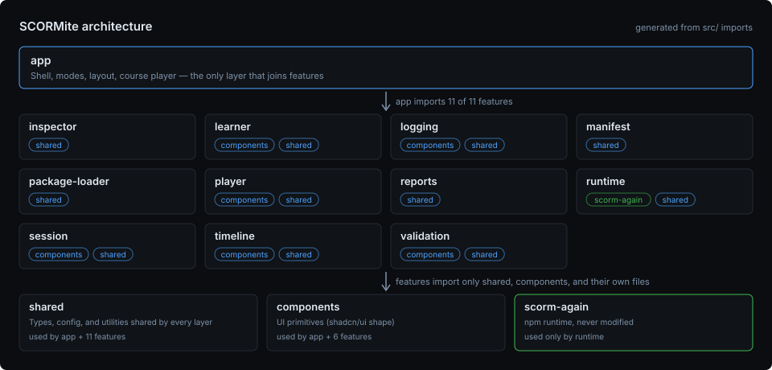

# Architecture

How SCORMite is built: its layers, folder structure, course player, panels,
accessibility baseline, and tooling. The rules and conventions for changing
it are in [Development](development.md); the original design rationale is
[archived](archive/original-design.md).

## Layers

```
UI (React)
  → Studio Services (pure application logic, no React/DOM)
    → Runtime Adapter (wraps scorm-again; the only layer allowed to import it)
      → scorm-again (npm dependency, never modified)
        → SCORM Package (iframe-sandboxed)
```



The diagram is drawn from the code's imports by `build/architecture.ts` —
`pnpm run diagram` regenerates it, and a unit test fails when the committed
copy no longer matches the code (or when one feature imports another). The
[About page](#about-page) draws the same diagram at build time, with live
file and line counts.

**Enforced, not just documented:** `eslint.config.js` uses `no-restricted-imports`
to block `scorm-again` imports outside `src/features/runtime/`,
`eslint-plugin-boundaries` to block one feature from importing another
(a feature may import only `shared`, `components`, and itself), and
`no-restricted-imports` again to keep the app layer on each feature's
`index.ts`. Run `pnpm run lint` — every rule is exercised by the
project's own code, so a regression here fails CI, not just code review.

## Folder structure

See each `src/features/<name>/README.md` for what that feature owns. The
top-level shape:

```
src/
  app/            # shell, mode switch, dock layout, course player (joins features)
  features/       # one folder per feature (see individual READMEs)
  components/     # shared dumb UI (shadcn-pattern primitives, icons)
  shared/         # cross-feature utilities, types, test helpers
```

## Modes

`useAppModeStore` (`src/app/state/appModeStore.ts`) is the single source of
truth for Basic vs. Advanced mode. Components read this store; nothing
branches on route or URL for mode switching.

The two mode shells are chrome only. `App` owns the single
`usePackageSession` subscription and renders a persistent player layer (the
SCO iframe) that is never unmounted, positioned behind whichever shell is
active — so switching Basic ↔ Advanced swaps the surrounding chrome without
detaching the iframe, which would destroy its browsing context and restart
the running course. The shells receive the session as a prop and never
render a second iframe.

## Loading and failure

- **On demand.** The start page's JavaScript is only the shell. The
  package runtime (`src/app/course/openPackage.ts`, with scorm-again,
  jszip, and the XML parser in their own `package-runtime` chunk — see
  `build.rolldownOptions` in `vite.config.ts`) and Advanced mode's dock
  (`React.lazy`) are separate files, both reached through
  `src/app/onDemandModules.ts`. Project modules are declared side-effect
  free (`"sideEffects": ["**/*.css"]` in `package.json`) so feature
  barrels do not pull the runtime into the start page — keep new modules
  free of import-time side effects, or list them there.
- **Fetched before they are needed.** Once the start page has loaded and
  the browser is idle, `preloadOnDemandModules` fetches both (Advanced
  mode only at desktop widths). Chunk names are content hashes, so a
  deployment replaces them; a tab that waited until the user switched
  modes would ask for a file that no longer exists. Fetched up front,
  switching modes and opening a package keep working across a deployment.
- **Errors.** `ErrorBoundary` (a class component) wraps the mode shells: a
  rendering failure shows a retry instead of a blank page, the header
  stays usable, and opening another package or switching modes clears it.
  An on-demand part that cannot be fetched is retried once through a fresh
  URL (`importWithRetry`, `src/app/moduleLoad.ts`) — a browser may
  remember a failed module fetch — so a dropped connection recovers on its
  own. If the retry fails too (a deployment replaced the file, or the
  connection is still down), it is explained without guessing the cause,
  with a reload; Basic mode, part of the start page's JavaScript, keeps
  working. Package load failures surface as `OpenPackageError` messages, or
  the same notice.

## State

One Zustand store per feature — see [Domain model](domain-model.md) for
what each store owns. Stores update only in response to `RuntimeEventEmitter` events
or explicit user actions; components never call the adapter directly.

## Course player

SCORMite plays the LMS for one course session. The course-session logic
lives in `src/app/course/` (the app layer, because it joins package-loader,
manifest, runtime, player, session, and validation):

| Piece                                                          | Kind           | Responsibility                                                                                                                                                                                                                                                                                    |
| -------------------------------------------------------------- | -------------- | ------------------------------------------------------------------------------------------------------------------------------------------------------------------------------------------------------------------------------------------------------------------------------------------------- |
| `getLaunchableItems` / `getActivityTree` (`features/manifest`) | pure functions | Launchable items in flow order (launch paths per the CAM `parameters` rules, `xml:base` applied); the SCORM 2004 activity tree with each activity's parsed `imsss` sequencing (`SequencingParser`)                                                                                                |
| `CourseSession`                                                | class          | One open package: starts the course, delivers SCOs, hands learner navigation to the engine, stores / restores attempts, publishes progress and navigation availability                                                                                                                            |
| `ScoLauncher`                                                  | class          | Builds runtimes (a fresh one per SCO, or one sequenced runtime per course) with the middleware pipeline, and delivers an item into a runtime: manifest launch data + stored attempt + `window.API` proxy                                                                                          |
| `CourseNavigator`                                              | class          | Flow-mode previous / next and resolution of SCO navigation requests                                                                                                                                                                                                                               |
| `AttemptStore`                                                 | class          | The LMS's persistence for the session: last stored attempt per item                                                                                                                                                                                                                               |
| `SessionPersistence`                                           | class          | Saved progress across reloads for 24 hours (IndexedDB behind a `KeyValueStore`; expired progress is deleted on load and at start-up): attempts, progress, current item, serialized sequencing state; keyed by manifest hash + zip size; saved on Commit (coalesced), Terminate and every delivery |
| `useCourseStore` (`app/state`)                                 | Zustand        | Items, current item, progress, navigation availability, pending launch / navigation; `go()` is the one entry point for navigation                                                                                                                                                                 |
| `usePackageSession` (`app/hooks`)                              | hook           | React glue: load / close packages, run pending launches and navigation through the `CourseSession`                                                                                                                                                                                                |

**Two ways to play a course.**

- _SCORM 2004 — sequenced._ The activity tree goes to scorm-again's SCORM
  2004 sequencing engine (`SequencingConfigBuilder` maps it; anything the
  engine cannot evaluate faithfully is reported as a `sequencing.unsupported`
  warning instead of approximated). One runtime serves the whole course:
  the engine's `start`, SCO-initiated `adl.nav.request`s, and the learner's
  outline / Previous / Next requests all go through it, and it announces
  each SCO to deliver; between SCOs the runtime is `reset()` (sequencing
  state survives). Outline items the rules do not allow are disabled using
  the engine's look-ahead (`predictChoiceEnabled` / continue / previous),
  Previous / Next honour `hideLMSUI`, and statuses come from the engine's
  rollup. If the engine cannot start the course it falls back to flow mode
  with a `sequencing.start-failed` warning.
- _SCORM 1.2 (and the fallback) — flow._ A fresh runtime per SCO, as
  scorm-again's multi-SCO guidance prescribes; navigation in manifest
  order, and a 2004 SCO's `adl.nav.request` is resolved by
  `CourseNavigator`.

**LMS-side data flow** — scorm-again end to end:

- _Before Initialize_ — `seedLaunchData()` loads the item's manifest data
  (`datafromlms`, `masteryscore`, `maxtimeallowed`, `timelimitaction`,
  `completionThreshold`, primary-objective `minNormalizedMeasure`) plus
  `cmi.core.credit` through `loadFromFlattenedJSON`.
- _Leaving a SCO_ — `exportAttempt()` stores scorm-again's terminate-commit
  payload (`renderCommitCMI(true)`, which accumulates `total_time`).
- _Resuming_ — `restoreAttempt()` feeds that record to `loadFromJSON` with
  `entry` set to `resume` after a `suspend` exit (blank otherwise).
- _Errors_ — every failed call records scorm-again's `GetErrorString` and
  `GetDiagnostic` on its `ApiCallRecord`; refused navigation requests
  become `sequencing.request-refused` warnings.

**Runtime version.** scorm-again 3.4.7. Upstream fixes are adopted by
upgrading, never by patching: 3.4.7 accepts values the specification allows
that earlier versions rejected (error 406), and fixes several sequencing
checks; 3.4.6 fixed a retried activity keeping its
previous primary-objective status (pinned by a test), and reports a
course's refused navigation through `onSequencingError` (with the IMS
exception code), which the adapter turns into a readable
`sequencing.request-refused` warning.

**Launch ordering.** Launches and engine navigation are two-step
requests: the request blanks the player (unmounting the old iframe, whose
unload handlers then call `LMSFinish` / `Terminate` on the _old_ runtime
state), and an effect performs the launch or navigation after that commit.
Injecting the next SCO's state first would route the old SCO's unload-time
calls into it.

**Session controls** (header, both modes): Open another package (or drop a
zip anywhere), Restart › Relaunch (resume) / New attempt / Restart whole
course, Report export, Close. A load error while a package is open is a
dismissible strip; the open session keeps running.

## Removed features

Features that did not earn their place were removed from the product and
the code, not just hidden (see the [Roadmap](roadmap.md) for when):

- The **plugin system**, and the **Storage** and **Console** panels — none
  was reachable from the UI any more.

- The **Performance** panel — in-memory API call timings say nothing about
  LMS performance; its per-method counts moved to the API Log.

- The **Reports** panel — it duplicated the header's Report export.

- **Moving panels between docks** (drag-and-drop, per-panel L / R / B dock
  buttons) and the **activity bars** — layout furniture that added
  controls and odd layout states without helping anyone test a package.

- **Runtime profiles** (Strict ADL / SCORM Cloud / Moodle / Canvas /
  SuccessFactors / Cornerstone) only toggled three SCORM 1.2 status
  switches and were never verified against those LMSs. The runtime uses one
  fixed rule set modelled on SCORM Cloud (`LMS_BASE_SETTINGS` in
  `ScormRuntimeAdapter.ts`), and every runtime validation rule always runs.

## Advanced-mode panels

Each panel has a fixed home dock, set in its definition (`region`), and a
purpose group (`group`: course / runtime / problems) the Panels menu uses.
`PanelRegistry` persists only show/hide choices and the active bottom tab;
dock sizes are persisted by react-resizable-panels. Moving panels between
docks was removed (see [Removed features](#removed-features)).

Every panel in `src/app/layout/panels.ts` (`ADVANCED_PANELS`) shows real
data from the running session and earns its place by answering a question a
tester actually has:

| Panel         | Owner            | Answers                                                                                                    |
| ------------- | ---------------- | ---------------------------------------------------------------------------------------------------------- |
| Outline       | `app/course`     | Where am I in the course, what may I open next, how did each item end?                                     |
| Manifest      | `manifest`       | What exactly did the manifest declare for this item (resource, href, parameters, launch data, sequencing)? |
| Files         | `package-loader` | Which files are in the zip, and which are launch files?                                                    |
| CMI Inspector | `inspector`      | What is in the data model now, and what just changed? (filter by path or value)                            |
| Validation    | `validation`     | What is wrong with the package or the run — including a status the LMS rules changed on exit, and why?     |
| API Log       | `logging`        | What did the course call, with what, and why did a call fail? (per-method counts, failed-only filter)      |
| Network       | `player`         | Which files did the course request, and which are missing from the package?                                |
| CMI History   | `timeline`       | What did the data model look like at any earlier point of this launch?                                     |
| Breakpoints   | `session`        | What is the state just before a specific SetValue / Commit is applied?                                     |

**Network.** The service worker (`public/sw.js`) posts a `FETCH_EVENT`
for every package-file fetch to **all window clients** — the SCO lives in a
sandboxed iframe, so `event.clientId` alone would never reach the app UI.
`networkMonitor.ts` records them into `useNetworkStore`.

**Breakpoints.** The SCORM API is synchronous: a SCO cannot be made to wait.
A breakpoint therefore _holds_ a matching `SetValue` or `Commit` — and every
mutation after it, Terminate included — answering `"true"` at once and
applying the held calls in order on Resume. Initialize, Terminate, and reads
are never breakpoint targets, because holding them would mean lying to the
course about whether it started or what a value is.

## Accessibility

WCAG 2.1 AA is an enforced baseline, verified by axe-core in two layers:

- **Structural audit (CI)** — `src/app/a11y.test.tsx` renders both modes
  (empty and data-rich states) under vitest + jsdom and asserts zero axe
  violations. Test infrastructure: `vitest.config.ts` +
  `src/test/setup.ts` (jest-dom matchers, the `toHaveNoViolations`
  matcher, an in-memory `localStorage` stub — Node's experimental global
  throws without `--localstorage-file` — and ResizeObserver/matchMedia/
  scrollTo mocks). Data-rich state is seeded by calling
  `useXStore.setState(...)` directly with real Manifest/Package/Network/
  log shapes.
- **Browser audit (e2e)** — axe's `color-contrast` rule cannot compute
  real colours in jsdom, so `e2e/accessibility.spec.ts` runs axe-core in
  Chromium on the start page, Basic mode, the Learner popover, Advanced
  mode with every panel open, and the phone layout's tabs, and fails on any
  WCAG 2.1 AA violation, contrast included.

Conventions the audits enforce:

- **Contrast tokens** — `src/index.css` `@theme` overrides Tailwind's
  default slate-500 (`#7f93ab`, 6.2:1) and slate-600 (`#6d829c`, 4.9:1)
  on surface-950; the Tailwind defaults (4.08:1 / 2.56:1) fail AA. Keep
  the 400 > 500 > 600 luminance hierarchy. slate-600 passes only on
  surface-950 / 900 (4.7:1 on 900); text on surface-800 or lighter —
  including hover backgrounds and inputs, placeholders too — uses
  slate-500 or lighter (4.95:1 on surface-700). The browser audit parks
  the pointer, so it does not see hover states: check them by hand.
  Bright accent fills (`bg-accent` #4da3ff) must not carry white text — `Button`'s default
  variant inverts to dark text on hover, and `destructive` uses dark text.
- **Scrollable regions are focusable** — every scroll container that
  users can tab into (every panel body plus the bottom-dock tabpanel)
  carries `tabIndex={0}` and a `focus-visible` ring; otherwise axe fires
  `scrollable-region-focusable` (which only appears when the container is
  _actually_ scrollable — empty-state audits miss it).
- **ARIA tabs** — `DockTabStrip` implements the tabs pattern: `role="tab"`
  buttons with roving tabindex, `role="tabpanel"` + `aria-labelledby`, and
  per-tab close controls as **siblings** of the tablist (a close button
  nested inside the tab is `nested-interactive`).
- **Tree semantics** — Files panel rows are `role="treeitem"` with
  `aria-level={depth + 1}` on every row; `aria-expanded` only on
  directories.

Tooling caveat: vitest-axe 0.1.0 is unmaintained against modern vitest —
import the matcher from `vitest-axe/dist/matchers` (the root entry is
`export type *`, breaking `verbatimModuleSyntax`) and augment the
`expect(...)` typing via `src/test/vitest-axe.d.ts` (jest-dom-style
`declare module 'vitest'`); vitest-axe's own `extend-expect` targets the
removed global `Vi` namespace and its runtime file is empty. ESLint allows
the augmentation-required `any`/empty-interface patterns for `**/*.d.ts`.

## Styling

Tailwind v4 via `@tailwindcss/vite` (no separate `tailwind.config.*` — theme
tokens live in `@theme` inside `src/index.css`). UI primitives follow the
shadcn/ui file convention (`src/components/ui/*.tsx`, `cn()` helper in
`src/shared/lib/utils.ts`, `components.json` at the root), so
`pnpm dlx shadcn add <component>` works; primitives written by hand (where
the CLI could not reach `ui.shadcn.com`) match the CLI's output shape.

## Tooling

| Concern                        | Tool                                                                        | Config                                                                                                                                                                                                                                                                                                                                                                                                                                                                                     |
| ------------------------------ | --------------------------------------------------------------------------- | ------------------------------------------------------------------------------------------------------------------------------------------------------------------------------------------------------------------------------------------------------------------------------------------------------------------------------------------------------------------------------------------------------------------------------------------------------------------------------------------ |
| Package manager                | pnpm                                                                        | `.npmrc`, `packageManager` field in `package.json`                                                                                                                                                                                                                                                                                                                                                                                                                                         |
| Build                          | Vite                                                                        | `vite.config.ts`                                                                                                                                                                                                                                                                                                                                                                                                                                                                           |
| Types                          | TypeScript (strict)                                                         | `tsconfig.app.json`                                                                                                                                                                                                                                                                                                                                                                                                                                                                        |
| Lint + architecture boundaries | ESLint flat config                                                          | `eslint.config.js`                                                                                                                                                                                                                                                                                                                                                                                                                                                                         |
| Format                         | Prettier                                                                    | defaults, via `pnpm run format`                                                                                                                                                                                                                                                                                                                                                                                                                                                            |
| Unit tests + coverage          | Vitest + @vitest/coverage-v8                                                | `vitest.config.ts` (`src/**` and `build/**` tests; thresholds 35/20/30/35, `pnpm run test:coverage`)                                                                                                                                                                                                                                                                                                                                                                                       |
| SEO / metadata                 | Vite plugin `build/seoPlugin.ts`, build inputs `build/seoContext.ts`        | Renders head tags, JSON-LD, no-JS fallback, robots.txt, sitemap.xml, llms.txt, llms-full.txt, manifest.webmanifest, and the published docs from `src/shared/config/seo.ts`. Per build: indexing (`SEO_INDEX`, or a preview build on Cloudflare, Vercel, or Netlify, gives `Disallow: /` and `noindex`), the sitemap's pages (the emitted HTML files) and lastmod (last commit to the page's sources), and the docs' text. See [Deployment](deployment.md#search-engines-and-ai-assistants) |
| Brand                          | `scripts/brand/mark.mjs`, `scripts/make-brand-assets.mjs`                   | The logo is generated from parameters on a 2:1 pixel-isometric integer grid (pixel-exact at native sizes): `logo-mark.svg` (dark surfaces), `logo-mark-24.svg` (24 px header), `logo.svg` (tile: favicon, README), PNG icons, and the social image — all committed                                                                                                                                                                                                                         |
| Architecture diagram           | `build/architecture.ts` (`pnpm run diagram`)                                | Draws `docs/architecture.svg` from the imports under `src/`; a unit test keeps it current                                                                                                                                                                                                                                                                                                                                                                                                  |
| About page                     | `build/aboutPage.ts`, `about/index.html`                                    | Credit, build details (also `build.json`), live diagram, open-source packages and `licenses.txt` from the bundle — see [About page](#about-page)                                                                                                                                                                                                                                                                                                                                           |
| IndexNow                       | `build/indexnow.ts` (`pnpm run indexnow`), `.github/workflows/indexnow.yml` | After a deploy, submits the pages whose content changed; key in `src/shared/config/seo.ts` and `public/<key>.txt` — see [Deployment](deployment.md#indexnow)                                                                                                                                                                                                                                                                                                                               |
| E2E                            | Playwright                                                                  | `playwright.config.ts` (`e2e/`, auto-starts dev server, committed fixtures in `e2e/fixtures/`)                                                                                                                                                                                                                                                                                                                                                                                             |
| CI                             | GitHub Actions                                                              | `.github/workflows/ci.yml` (unit + e2e jobs; e2e runs in the `mcr.microsoft.com/playwright` image matching `@playwright/test`, so it needs no system packages); `.github/dependabot.yml` (weekly grouped updates)                                                                                                                                                                                                                                                                          |

## About page

`about/index.html` (served at `/about/`) is a second page of the build,
rendered at build time by `build/aboutPage.ts`: the developer credit (from
`author` in `src/shared/config/seo.ts`), the build (commit from the host or
git, and the build date), the architecture diagram with live
counts, and the open-source packages the build ships. That list comes from the
npm packages whose modules are in the production bundle (plus Tailwind, whose
CSS ships without a JavaScript module), and their full licence texts are
emitted as `/licenses.txt`. The build details are also emitted as
`/build.json`, which [IndexNow](deployment.md#indexnow) reads to know when a
deploy is live. The dev server shows the direct dependencies
instead. The page uses the app's stylesheet and no JavaScript, and is linked
from the start page and the no-JS fallback.

## WebMCP

`src/app/webmcp/` registers SCORMite's tools on `document.modelContext`
([WebMCP](https://webmachinelearning.github.io/webmcp/)) so agents in the
user's browser can read and drive the open session — the tools are listed in the
[AI agents](ai-agents.md) guide.

- `modelContext.ts` types the slice of the API SCORMite uses (TypeScript's DOM
  library does not describe it yet) and feature-detects it; without WebMCP
  nothing is registered.
- `tools.ts` (session tools) and `qaTools.ts` (test plan, audit, manifest,
  files, the running page, network, CMI history, breakpoints, learner) define
  the tools over the app's stores and a small `ToolHost`
  (the session's actions and the mode switch). Results are JSON-serializable
  objects; preconditions are checked when a tool runs and reported as
  `{ error }` with what to do instead.
- `contentTools.ts` reviews content (all the course's text, search,
  reference checks, the assessment data) and records review findings as
  validation issues with `source: 'review'`; `securityTools.ts` scans the
  package and hashes files; `automationTools.ts` calls the SCORM API as the
  SCO does, runs scripts in the SCO's page, waits for a state, and opens or
  closes a package. The pure logic they use is in `contentScan.ts` (page and
  caption text, references), `assessment.ts` (interactions and objectives
  from the flat CMI), and `securityScan.ts` (the security rules).
- `audit.ts` holds the pure logic behind `audit_session` and
  `get_test_plan`; `scoPage.ts` reads the running SCO's page (text, headings,
  images, controls, accessibility) and operates its controls by
  `data-scormite-ref` — the SCO frame is same-origin, so its document is
  reachable directly.
- `useWebMcpTools` (called from `App`) registers them once, reads the latest
  session through a ref, and unregisters them on unmount through the
  registration's `AbortSignal`. The tools are their own chunk, imported only
  when the browser has WebMCP, so the start page does not carry them.

Two rules keep agents safe. Tools that return package content — titles, CMI
values, API arguments, manifest text — carry `untrustedContentHint`, since a
package could embed instructions aimed at an agent. Tools that discard
tracking data, call the SCORM API, run code in the SCO, or open or close a package carry
`consequentialHint`, so the browser can confirm with the user.
`run_script_in_sco` runs with the SCO's own access and no more. A package
runs with SCORMite's origin (the SCORM API requires it), so its scripts can
reach the page's `document.modelContext` too — the same trust boundary as the
rest of the page, stated in [SECURITY.md](../SECURITY.md).

Chrome and Edge ship WebMCP as an origin trial; a deployment enables it with
its trial tokens (`WEBMCP_ORIGIN_TRIAL_TOKENS`, see
[Deployment](deployment.md#build-settings)), which `build/originTrial.ts`
adds as `<meta http-equiv="origin-trial">` tags.

## Adding a new feature

1. `mkdir src/features/<name>` with `README.md` + `index.ts` (barrel) at minimum.
2. Add it to the [Roadmap](roadmap.md) if it's not already there.
3. It must not import another feature — `eslint-plugin-boundaries` fails
   the build. Types used by both go in `src/shared/types/`; logic that
   joins features goes in `src/app/`.
4. If it needs scorm-again, it doesn't — go through `@/features/runtime`
   instead. `no-restricted-imports` will fail the build otherwise.

## Architecture decision records

Non-obvious or debatable technical choices get a
[decision record](adr/README.md), not just a comment — for example
[ADR 0001](adr/0001-eslint-architecture-boundaries.md), on enforcing these
boundaries with ESLint.
